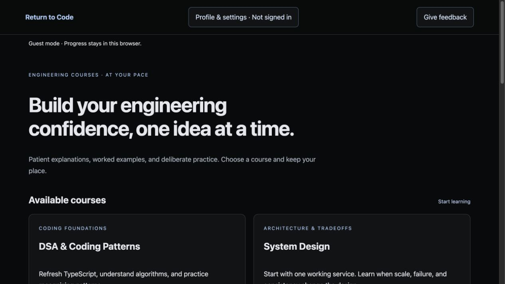

# Return to Code

**Return to Code is a self-paced engineering study tool for developers refreshing their skills and preparing for technical interviews.**

Learn through explanations, worked examples, concept checks, and practice. Follow your own pace and move between lessons freely.

**[Start learning at return-to-code.com →](https://return-to-code.com/)**

This is the public project showcase. The application source is maintained privately. The website is publicly accessible and currently free.

## Start learning

1. Open [Return to Code](https://return-to-code.com/).
2. Choose DSA & Coding Patterns or System Design.
3. Study as a guest, or use optional Google sign-in to sync your progress across devices.

Guest progress stays in that browser. Export a backup before changing browsers or site addresses. Signing in loads account progress; guest work is not uploaded automatically.

## Available courses

| Course | What you study | Practice |
| --- | --- | --- |
| [DSA & Coding Patterns](https://return-to-code.com/dsa.html#welcome) | TypeScript foundations, data structures, algorithms, and problem-solving patterns across 11 teaching modules | 190 linked LeetCode problems and 208 concept checks |
| [System Design](https://return-to-code.com/system-design.html#welcome) | Requirements, databases, concurrency, distributed systems, scaling, and tradeoffs across 12 modules | 48 lessons, 12 worked cases, and 12 design exercises |

DSA is a learning companion and roadmap: it links to LeetCode for the actual coding questions and submissions. Reference articles and videos provide optional deeper study.

## How you learn

- Read one page at a time, with persistent course navigation.
- Try concept checks and revisit explanations after an incorrect answer.
- Track coding completion and confidence on a 1–4 scale.
- Highlight passages and attach personal notes.
- Work through System Design exercises with free-form writing and an optional diagramming whiteboard.
- Prepare an answer-and-diagram packet for manual review in Codex or Claude. The website does not make AI API calls to grade your work.
- Save browser backups or use optional Google account sync. Learner profiles and feedback are private.

There is no mandatory daily schedule. Completion records your study; it is not an accredited certificate or a guarantee of interview success.

## Planned courses

These topics are planned, not available courses. No release dates are promised.

- LLM Applications & Agent Engineering
- Cloud & Deployment Fundamentals
- Databases & Data Modeling
- Computer Networking
- Computer Architecture & Systems Programming

## Why I built it

I created Return to Code for my own return to focused study, then expanded it into a resource others could use. The emphasis is comprehension: rebuild the reasoning, trace small examples, and practice explaining the tradeoffs.

I developed the course and website with AI assistance, including OpenAI Codex. I direct the project and take responsibility for what I publish. AI-assisted explanations can contain errors; linked sources and learner feedback help identify corrections.

## Feedback and contact

Use **Give feedback** on the website to send private course feedback after signing in. For general questions, contact [hello@erickbenitez.com](mailto:hello@erickbenitez.com).

[Privacy notice](https://return-to-code.com/privacy.html) · [Erick's portfolio](https://erickbenitez.com/)

## Credits and reuse

Return to Code is independent and is not affiliated with or endorsed by employers, universities, LeetCode, or other linked platforms. Third-party materials retain their owners and terms.

The original text and screenshot in this showcase use [CC BY 4.0](https://creativecommons.org/licenses/by/4.0/). See [LICENSE.md](LICENSE.md) for scope and attribution. This showcase does not distribute the application source or the course library. Earlier public releases retain the licenses granted with those releases.
